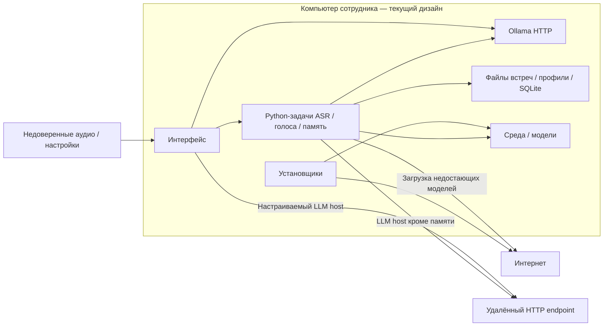
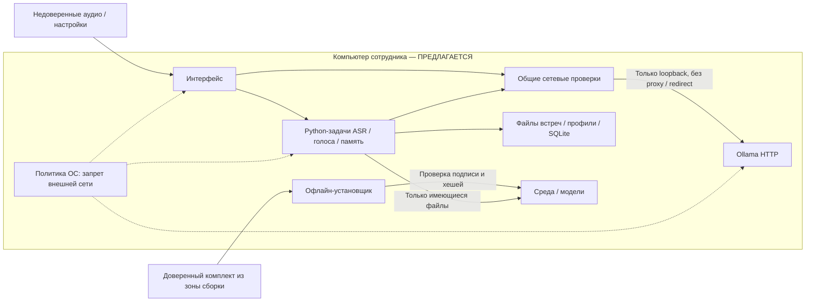
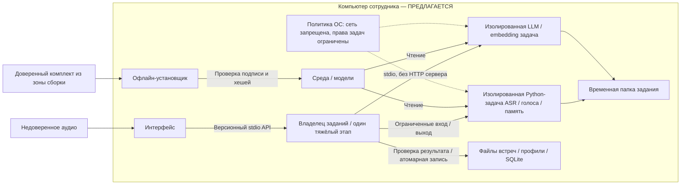

# Security Hardening Proposal: единая офлайн-среда Славатора

## Decision

Предлагаем выбрать границу исполнения и поставки для закрытого рабочего места. Архитектурная миграция ещё не выполнена. Этот документ не является сертификатом, полным аудитом или подтверждением устранения уязвимостей.

## Executive Recommendation

У нас два реальных варианта: **Option 1 — офлайн-профиль текущего стека** (`local-guards`), сохраняющий Ollama и существующие процессы; **Option 2 — единое упакованное ядро с изолированными заданиями** (`owned-worker`), которое владеет жизненным циклом моделей и убирает универсальный HTTP-сервис из рабочего контура.

Я рекомендую второй вариант как целевую корпоративную архитектуру, но без одновременного переписывания интерфейсов и распознавания. Мы можем сохранить faster-whisper и sherpa-onnx внутри общей границы, а замену отдельных движков решать измерениями. Первый вариант разумен при коротком сроке поставки, если ИБ разрешает управляемый loopback-сервис и обеспечивает запрет внешней сети средствами ОС.

## Evidence

Я просмотрел перечисленные ниже участки текущего изменённого дерева и выполнил локальный CPU-замер. Наибольшее влияние на вывод оказало различие сетевых правил между клиентами: локальность уже реализована в памяти встреч, но не является общим свойством приложения. Хеши 13 исходных файлов и отличие от HEAD зафиксированы в [контексте](../context.md).

| Evidence | Finding or document | What it establishes |
| --- | --- | --- |
| E1 | Разрозненные сетевые клиенты | Наблюдается: `core/meeting_transcriber_v25_1.py::_http_json`, `core/dictation_worker.py`, `app/Chat.swift::stream` используют настраиваемый адрес. `core/speaker_memory.py::Embedder` отдельно запрещает proxy/redirect и фиксирует loopback. |
| E2 | Загрузка моделей во время работы | Наблюдается: `core/onnx_engine.py::ensure_models` загружает отсутствующие файлы; `whisper_model` и dictation не задают обязательный local_files_only. |
| E3 | Интернет-установка без зафиксированного набора | Наблюдается: `packaging/setup.command`, `windows/install.ps1` скачивают компоненты; `packaging/requirements*.txt` содержит диапазоны версий, а не проверенный офлайн-манифест. |
| E4 | Независимые сроки жизни моделей | Наблюдается: ASR освобождается между этапами, но LLM удерживается 10 минут, embedding 5 минут, диктовка отдельно. Единого владельца ресурсоёмких заданий нет. |
| E5 | Производные данные на диске | Наблюдается: `core/speaker_memory.py`, `core/speaker_links.py` и основной pipeline сохраняют открытые JSON/SQLite/голосовые образцы. Атомарная запись и файловые права не обеспечивают шифрование и полное удаление. |
| E6 | Измеренный CPU-профиль | Эксперимент: `docs/benchmarks/cpu-2026-09-08.json`: 45 секунд, small beam5 — ASR 4,242 с, диаризация 5,157 с, пик 972,5 МиБ процесса; turbo beam1 — 2209,9 МиБ. Не WER/DER и не Windows/Ubuntu. |

**Вывод, а не отдельное наблюдение:** E1–E4 показывают распределённую ответственность за доступ к сети, поставку и память. Мы не можем вывести свойство «полностью офлайн» из одного локального клиента или наличия весов на диске. Это структурная возможность усиления, а не утверждение об эксплуатации.

## Current Design And Failure Mode

Мы принимаем аудио неизвестного происхождения и запускаем нативные декодеры, Python-обработчики и модели с правами пользователя. Настройки также влияют на адрес LLM. При неполной установке некоторые обработчики сами выходят за весами; клиент чата может использовать удалённый адрес. Поэтому отсутствие намеренной облачной функции не является запретом исходящих соединений. Проверка `/api/version` узнаёт протокол Ollama, но не аутентифицирует доверенный процесс.

Если мы просто уменьшим модель, это снизит нагрузку одного этапа, но не исключит соседнюю диктовку и удерживаемую LLM. Аналогично SQLite делает поиск быстрым и восстанавливаемым, однако создаёт дополнительную копию конфиденциального текста. Эти свойства связаны с владельцем жизненного цикла, а не с выбором языка программирования.

Здесь мы рассматриваем ошибочную конфигурацию, подменённый комплект и потенциально вредоносное медиа как входы риска. Мы не доказали конкретную ошибку декодера и не обещаем защиту от администратора, читающего память машины.

## Desired Invariants

Мы хотим проверять поведение, а не наличие настроек:

- Во время обработки нет DNS и внешних сетевых соединений, включая дочерние процессы, прокси, перенаправления и загрузку отсутствующих моделей.
- Загружаются только заранее поставленные компоненты из проверенного подписанного манифеста; отсутствие или подмена файла даёт понятную ошибку без скачивания.
- Одновременно исполняется не более одного тяжёлого этапа; отмена завершает его процесс, освобождает модель и не удаляет исходник.
- Результат задания проходит проверку схемы до записи; сбой оставляет предыдущую корректную версию.
- Голос без уверенной атрибуции остаётся неизвестным. Предположение языковой модели не становится биометрической идентичностью.
- Политика хранения охватывает аудио, тексты, WAL, векторы, образцы, временные файлы и резервные копии; диагностические журналы не содержат цитат.

## Constraints And Non-Goals

Мы поддерживаем русский с англицизмами/аббревиатурами, 8 ГБ RAM, CPU без NVIDIA, macOS/Windows/Ubuntu. Внутренний сервер тоже исключён. Комплект можно подготовить в отдельной разрешённой зоне сборки и перенести по процедуре ИБ; работа сотрудника остаётся офлайн.

Мы не обещаем одинаковый захват системного звука на трёх ОС без платформенных адаптеров. Смена SwiftUI/Tk не нужна для унификации обработки. Не включаем облако, автоматическое обновление из интернета, обязательную CUDA или тяжёлый PyTorch-стек. Классификация данных, сроки хранения, требования к шифрованию и лицензии весов требуют отдельного решения; отсутствие токена загрузки не является лицензионным заключением.

## Before Architecture

На схеме мы оставляем только границы, которые действительно есть. Процессы работают в пользовательском контексте; отдельный защищённый диспетчер здесь не подразумевается.

[Исходник схемы](../diagrams/offline-runtime-before.mmd). Самые важные стрелки — прямые обращения обработчиков к сети и независимый доступ к данным: сейчас общая политика их не охватывает.

## Options

### Option 1: офлайн-профиль текущего стека

Мы сохраняем знакомую эксплуатацию: интерфейсы запускают Python, а установленная локальная Ollama обслуживает модели. Общая конфигурация становится закрытым профилем: только разрешённый loopback, без прокси/redirect, без пользовательского remote host, без автозагрузки. Установщик получает готовую среду и веса, проверяет подпись манифеста и каждый хеш. Правило ОС запрещает внешнюю сеть приложению и всем дочерним компонентам.

Сильная сторона этого варианта — небольшая площадь миграции. Мы не меняем форматы встреч, можем оставить быстрый тёплый запуск модели и воспользоваться существующими интерфейсами. Но проверку каждого клиента всё равно придётся поддерживать: новая интеграция способна обойти общую функцию, если контроль ОС отсутствует. Loopback также не защищает от другого процесса того же пользователя, а декодер продолжает иметь широкие файловые права.

По памяти мы можем добавить общий запрет параллельных тяжёлых операций и явную выгрузку Ollama. Это не доказывает, что сторонний клиент не загрузит в неё ещё модель. По надёжности отсутствие автоскачивания превращает неполную установку в диагностируемую ошибку, но требует качественной проверки комплекта до запуска.

Мы можем внедрить такой профиль без переноса документов: сначала собрать офлайн-пакет, затем включить закрытые настройки и провести испытание с контролем сети. Откат — предыдущий подписанный пакет при сохранении запрета внешней сети; возвращать онлайн-установщик в закрытый контур нельзя. Этот вариант я бы выбрал для раннего ограниченного пилота, если служба ИБ принимает остаточную файловую и loopback-поверхность.

[После: локальные проверки](../diagrams/offline-runtime-local-guards-after.mmd), сравниваем с исходной схемой выше.

| Change | Before | After | Security consequence | Cost |
| --- | --- | --- | --- | --- |
| Сеть | Разные правила клиентов | Общие проверки + запрет ОС | Внешняя передача блокируется при корректной политике | Поддержка правил для каждой ОС |
| Поставка | Runtime download / pip ranges | Проверенный офлайн-комплект | Подмена/недокомплект выявляются до обработки | Сборка и обновление комплекта |
| Полномочия | Пользовательские процессы | Те же процессы | Файловый риск существенно не меняется | Малый объём миграции |

На схеме нет новой песочницы: мы сознательно не приписываем локальным проверкам изоляцию. Именно это отличает быстрый пилот от следующего варианта.

### Option 2: единое упакованное ядро с изолированными заданиями

Мы сохраняем движки ASR и голосов, но переносим владение работой в один локальный диспетчер с версионным stdio-протоколом. SwiftUI и Windows/Ubuntu-оболочки передают ему задания, а не адреса сервисов или произвольные команды. Он выдаёт ограниченные входы и отдельную временную папку, запускает только разрешённый обработчик и принимает результат после проверки схемы. Декодирование медиа находится внутри ограниченного процесса, а не привилегированного диспетчера.

Для резюме и embedding мы постепенно заменяем общий Ollama HTTP на принадлежащие приложению локальные worker-процессы. Это не означает, что произвольный бинарник автоматически безопасен: его модель, библиотека и сетевые возможности входят в проверяемый комплект. Мы должны испытать отдельный запуск LLM/embedding с чтением только локальных весов и запретом сети средствами ОС. Удаление HTTP уменьшает поверхность конфигурации и взаимодействия с посторонними клиентами, но не заменяет контроль файловых прав.

Привлекательная часть для 8 ГБ — тот же диспетчер становится владельцем памяти. Он не держит ASR, диаризацию и резюме одновременно; завершение процесса гарантированнее освобождает нативные аллокации, чем сборщик мусора. За это мы платим холодной загрузкой моделей, задержкой очереди и дополнительными контрактами отмены. Я не обещаю ускорения: при коротких запросах тёплая Ollama может оказаться быстрее. Мы измерим задержку первого ответа и суммарный пик всех процессов, а не только одного рабочего процесса.

Платформенная изоляция — самая дорогая часть варианта. Мы не должны назвать обычный subprocess песочницей. Для каждой ОС потребуется проверить механизм ограничения сети, доступных папок и дерева процессов; например, допустимость restricted token/Job Object и отдельного правила сети на Windows, sandbox-профиля на macOS, namespaces/seccomp на Ubuntu. Эти механизмы не взаимозаменяемы, их доступность в корпоративном образе пока неизвестна. Если они недоступны, мы честно получаем лишь централизованное ядро, а не заявленную изоляцию.

По надёжности падение обработчика не должно завершать интерфейс или портить индекс. Но диспетчер становится важным доверенным компонентом: ему нужны ограниченные очереди, лимиты размера сообщений, проверка идентификаторов заданий и защита от устаревших ответов. Постепенный запуск через существующие адаптеры позволит сравнить результаты на одном наборе аудио. Старые файлы встреч останутся источником истины; новые индексы можно перестроить.

Мы будем вводить границу по этапам, сначала сохранив распознавание и формат данных, затем заменив LLM-транспорт и добавив реальные ограничения ОС. Старый и новый путь можно держать в тестовой сборке за явным переключателем, но корпоративная сборка не должна незаметно откатываться на сетевой режим. Обратный переход возможен на последний проверенный офлайн-пакет и совместимую копию индекса. Этот путь дольше, зато мы получаем одного владельца политики, который действительно общий для трёх ОС.

[После: изолированные задания](../diagrams/offline-runtime-owned-worker-after.mmd), сравниваем с исходной схемой выше.

| Change | Before | After | Security consequence | Cost |
| --- | --- | --- | --- | --- |
| Владелец задания | Независимые вызовы | Версионный диспетчер | Единая проверка полномочий и результата | Протокол и тесты совместимости |
| Декодер / модели | Права пользователя | Ограниченные worker-процессы | Меньший доступ к чужим данным при сбое | Разная изоляция на ОС |
| LLM-транспорт | Общий HTTP-сервис | Принадлежащий приложению stdio worker | Нет произвольного адреса/сервера | Миграция inference, холодный старт |
| Модели / память | Независимое удержание | Последовательные этапы и выход процесса | Ограничение истощения памяти | Очередь и повторная загрузка |
| Поставка | Интернет-установщик | Подписанный офлайн-комплект | Проверяемое происхождение | Сборочная инфраструктура |

Ключевой переход — от доверия к каждому отдельному клиенту к ограниченным задачам. Подпись комплекта и права ОС остаются необходимыми: схема сама по себе не обеспечивает ни того, ни другого.

## Comparison

Сравнение относится к предлагаемым изменениям, а не к уже измеренному эффекту. В таблице указываем направление, уверенность и основание; детальные планы проверки также сохранены в [структурированном анализе](../hardening.json).

| Измерение | Option 1 | Option 2 | Что проверяем |
| --- | --- | --- | --- |
| Security | improves / medium / source-derived: меньше сетевых обходов | improves / medium / source-derived: единый владелец и ограничение прав | DNS, proxy, redirects, дочерние процессы, доступ вне задания |
| Performance | unknown / low / hypothetical: выгрузка может замедлить | unknown / low / hypothetical: холодный старт и очередь | RTF, p95 первого ответа на одном корпусе |
| Memory | improves / medium / source-derived: выгрузка, но Ollama общая | improves / medium / source-derived: один этап и выход worker | Сумма RSS, swap, соседняя диктовка/поиск на 8 ГБ |
| Reliability | improves / medium / source-derived: ранняя ошибка комплекта | improves / medium / source-derived: падение задачи локализовано | Отмена, crash, диск заполнен, недостающий файл |
| Operability | regresses / medium / source-derived: нужен офлайн-релиз | regresses / high / source-derived: ещё и три профиля изоляции | Чистая установка/обновление без прав разработчика |
| Migration | regresses / medium / source-derived: установщики и клиенты | regresses / high / source-derived: протокол и inference workers | Старые результаты/настройки, повторная индексация |
| Developer ergonomics | unknown / medium / source-derived: меньше API-изменений, больше мест контроля | improves / medium / source-derived: один контракт, сложнее harness | Добавление тестового обработчика без сетевых прав |
| Rollback | neutral / medium / source-derived: старый офлайн-пакет | unknown / medium / source-derived: совместимость протокола/индекса | Репетиция downgrade без потери документов |

Мы выигрываем во втором варианте прежде всего в управляемости полномочий и памяти, а не в количестве новых технологий. Дополнительная сложность оправдана, только если команда готова владеть поставкой и платформенными тестами.

## Recommendation

Я рекомендую Option 2 как цель для закрытой ИС, с первым вариантом как возможным контролируемым пилотом. Если ИБ допускает общий loopback-сервис и нужен очень короткий срок, Option 1 может быть достаточным после испытаний. Если запрещены слушающие порты или требуется ограничение файловых полномочий декодера, нам нужен второй вариант.

Для начала мы оставляем **faster-whisper small, CPU int8 + sherpa-onnx + SQLite**. Словарь терминов и тестовый корпус важнее необоснованного перехода на самый большой Whisper. Поддержку CPU и word timestamps подтверждает [faster-whisper](https://github.com/SYSTRAN/faster-whisper), кроссплатформенную офлайн-диаризацию — [sherpa-onnx](https://github.com/k2-fsa/sherpa-onnx). Установленный GigaAM CTC в текущем адаптере ограничен кириллическим алфавитом, поэтому мы не делаем его основным для латинских сокращений.

[whisper.cpp](https://github.com/ggml-org/whisper.cpp) заслуживает A/B-проверки как компактный движок для трёх ОС, но его превосходство на наших встречах не измерено. [llama.cpp](https://github.com/ggml-org/llama.cpp) — кандидат для принадлежащего приложению LLM-worker, а не обещанная замена без затрат. Модель [Qwen3-1.7B](https://huggingface.co/Qwen/Qwen3-1.7B) можно испытать вместо тяжёлой 8B; качество русских резюме ещё не проверено, по умолчанию её не включали. Лицензии движка и весов проверяем отдельно, как прямо напоминает [документация sherpa-onnx](https://k2-fsa.github.io/sherpa/onnx/speaker-diarization/apk.html).

## Evidence Coverage And Residual Risk

Оба варианта пока предлагаются. Слово addresses ниже означает ожидаемое покрытие после реализации и проверки, а не закрытую проблему.

| Evidence | Option 1 | Option 2 | Тактическая работа остаётся |
| --- | --- | --- | --- |
| E1 — Разрозненные сетевые клиенты | mitigates | addresses | Да: закрыть все клиенты, тестировать обходы и политику ОС |
| E2 — Загрузка моделей во время работы | addresses | addresses | Да: local-only и отказ при отсутствии модели |
| E3 — Интернет-установка | addresses | addresses | Да: lock, SBOM, лицензии весов, подпись/хеши, офлайн-обновление |
| E4 — Независимые сроки жизни моделей | mitigates | addresses | Да: отмена, последовательность, тесты всего процесса/системы |
| E5 — Производные данные | unaffected | mitigates | Да: политика хранения, ACL, временные файлы; шифрование — отдельное решение |
| E6 — CPU-замер одного фрагмента | unknown | unknown | Да: корпус точности и реальные Windows/Ubuntu 8 ГБ |

Мы сохраняем остаточные риски ошибочной атрибуции, уязвимостей нативных библиотек, чтения данных под привилегированной учётной записью и неполного удаления резервных копий. Изоляция уменьшает последствия, но не делает неверный текст верным и не заменяет обновления зависимостей. Согласование ИБ невозможно гарантировать без её требований.

## Migration And Rollout

После выбора мы сначала сверяем хеши снимка: функциональные изменения могут затронуть эти границы. Затем формируем проверяемый комплект и сохраняем текущие защитные меры памяти встреч: фиксированный loopback, запрет proxy/redirect, явная неизвестная атрибуция, атомарная запись.

Пилот проводим на копиях результатов без перезаписи исходников. Общий API вводим за адаптерами интерфейсов, данные мигрируем только версионно с резервной копией. Расширяем развёртывание после тестов ОС и утверждения ИБ. Откат репетируем на предыдущий офлайн-пакет, сохраняя совместимость документов; отключение защит ради запуска не считаем допустимым откатом.

## Validation Plan

Мы задаём предварительные инженерные критерии, которые нужно согласовать, а не выдаём их за достигнутые:

- Чистые macOS/Windows/Ubuntu без сети: установка из комплекта, транскрипция, диаризация, поиск, экспорт; ноль DNS/внешних соединений при мониторинге ОС, включая отрицательные сценарии.
- Подмена модели/библиотеки, неправильная подпись, недостающий файл: отказ до исполнения; никакой попытки скачивания.
- Корпус не менее 20 согласованных фрагментов, включая шум, пересечения голосов, аббревиатуры и 2–6 спикеров. Вручную размечаем текст/голоса, считаем WER/CER, ошибки терминов, DER и ошибочную идентификацию отдельно.
- Для смены движка предлагаем барьер: ухудшение WER/DER не более 1 процентного пункта относительно согласованного baseline при реальной экономии памяти/времени; сам baseline должен сначала пройти оценку пользователя.
- На офисных 8 ГБ: полный часовой файл, холодный/тёплый запуск, чат и поиск в очереди; измеряем совокупный RSS и swap. Предварительная цель — не более 3,5 ГиБ процессов приложения, без OOM и зависания UI; E6 этого не доказывает.
- Предварительный ориентир скорости: RTF не хуже 1 для ASR+диаризации на согласованном CPU. Для интерактивного поиска p95 до 2 с на индексе 100 встреч после прогрева; измеряем также холодный старт.
- Прерываем каждую фазу, завершаем worker аварийно, заполняем диск, проверяем старые документы, очистку временных файлов и повторный запуск.
- Испытываем ограничения на специально подготовленном обработчике: сеть и чтение файлов вне задания запрещены. Права администратора не требуются при обычном использовании.
- Проверяем обновление/откат и процедуру удаления с WAL, векторами, образцами и резервными копиями; журналы не должны содержать содержимое встреч.

## Implementation Work Packages

Это границы будущих работ, не разрешение начать миграцию:

| Пакет | Компоненты | Условие приёмки |
| --- | --- | --- |
| Проверенная поставка | packaging, windows, новый Ubuntu-пакет | Воспроизводимый комплект, lock/SBOM/лицензии/подпись, установка офлайн |
| Локальная политика | app_config, Chat, dictation, downloader | Все негативные сетевые сценарии закрыты |
| Контракт заданий | pipeline, memory, платформенные адаптеры | Версионный API, лимиты, отмена, отсутствие устаревших ответов |
| Владение inference | ASR/ONNX/LLM/embedding workers | Последовательность и ресурсные замеры на 8 ГБ |
| Ограничения ОС | Профили macOS/Windows/Ubuntu | Доказанный отказ сети и доступа вне задания |
| Жизненный цикл данных | Индекс, образцы, временные файлы | Утверждённые хранение/удаление/ключи, проверенный откат |

Для первого варианта мы ограничиваем пакет контракта общим управлением запуском и не заявляем изоляцию. Для второго владельцем всех тяжёлых работ становится диспетчер. Подробный implementation-план появится только после выбора варианта.

## Open Questions

Нам нужны требования ИБ к локальному HTTP, установочным правам, подписи, шифрованию и хранению голосовых профилей; конкретные версии ОС и типичный CPU; согласованный размеченный корпус; допустимая задержка резюме. Выбор пользователя сейчас — целевой Option 2 или более короткий пилот Option 1. До этого мы не меняем архитектуру поставки и не выдаём текущую сборку за допущенную к закрытой ИС.
